# Tesserae docs for the Seeed Wiki and Firmware Hub

Drafts of two contributions, for review by the Seeed team before the pull requests go in:

| Contribution | Status | Goes to |
|---|---|---|
| [Work with Tesserae](wiki/work_with_tesserae.md), a Wiki page for the reTerminal E1001, E1002, E1003, E1004 and Sticky | First draft, ready for review | [Seeed-Studio/wiki-documents](https://github.com/Seeed-Studio/wiki-documents), at `sites/en/docs/Sensor/ePaper_Displays/Application/work_with_tesserae.md` |
| [Firmware Hub entry](firmware-hub/), an Official Platforms card for the E1001–E1004, EE02 and EE03 | First draft, ready for review | [Seeed-Projects/OSHW-reTerminal-Series-E-D](https://github.com/Seeed-Projects/OSHW-reTerminal-Series-E-D) |

The Wiki page follows the structure of the existing [Work with TRMNL](https://wiki.seeedstudio.com/reterminal_e10xx_trmnl/) page: overview, compatible hardware, numbered steps from install to first dashboard, buttons and touch, firmware updates, FAQ, resources and the standard support footer. Hardware differences are handled with tabs, as on the TRMNL page.

## Reviewing

Comment however suits you: reply by email, open an issue here, or comment on a commit. Wording, structure and anything that doesn't match the Wiki's house style are all welcome.

GitHub shows the page's text and images, but not its Docusaurus parts: the tabs appear as plain sections and the tip and caution boxes as plain text. The screenshots are also listed below in page order.

## Images

In this copy, the page loads its images from [`wiki/images/`](wiki/images/). For the pull request they'll point at `https://files.seeedstudio.com/wiki/reterminal_e10xx/img/tesserae/<file>`, once your team has uploaded them there. Please tell me if you'd rather I name or size them differently, or if your team prefers another folder.

The screenshots come from a Tesserae server taken through the full setup with a reTerminal Sticky (480×800, 4-level greyscale).

| Section | File | Shows |
|---|---|---|
| What is Tesserae? | `15-editor-html-view.png` | The dashboard editor |
| Step 1, first run | `01-first-run-set-password.png` | Choosing a password on first open |
| Step 1, first run | `02-wizard-welcome.png` | The setup wizard's welcome step |
| Step 1, first run | `05-wizard-transport.png` | Transport step, REST selected |
| Step 1, first run | `06b-wizard-device-discovered.png` | Device step, a Sticky that has announced itself, ready to register |
| Step 3 | `07-device-setup-portal-phone.png` | The device's Wi-Fi setup page on a phone |
| Step 4 | `08-devices-discovered.png` | Settings → Devices, a new device waiting for approval |
| Step 4 | `09-register-name-device.png` | Naming the device before registering |
| Step 4 | `10-device-registered.png` | The registered device's card |
| Step 5 | `16-editor-panel-view.png` | Editor preview in Panel view, the exact frame the device paints |
| Step 5 | `13-device-card-after-push.png` | The device card after the first push |
| Buttons and Touch | `sticky-touch-lights.png` | A touch-controls page rendered for the Sticky |
| Firmware Updates | `19b-firmware-update-available-crop.png` | Settings → Firmware, an over-the-air update available |

Preview every image

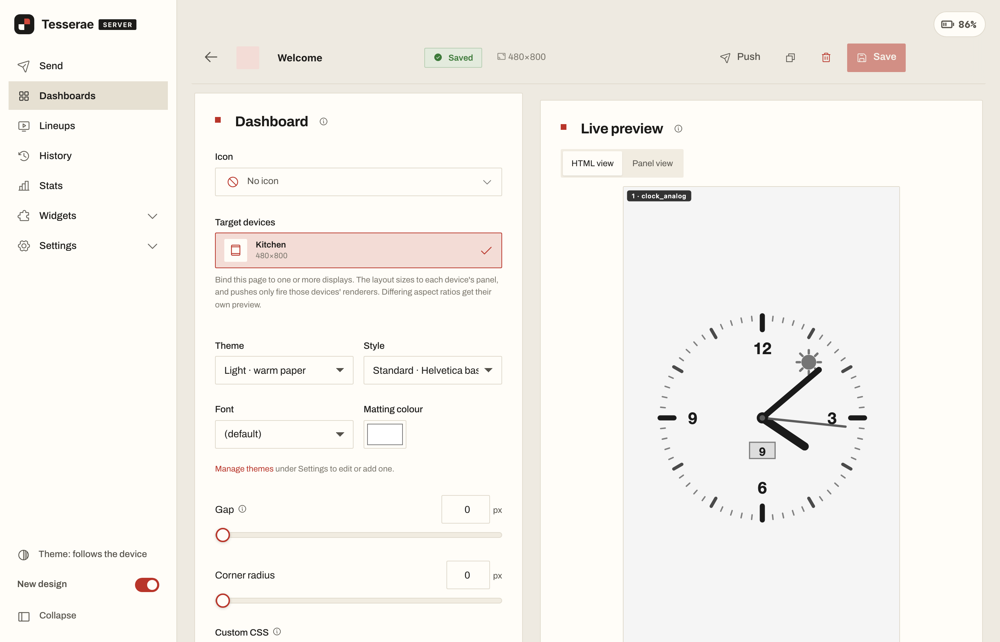

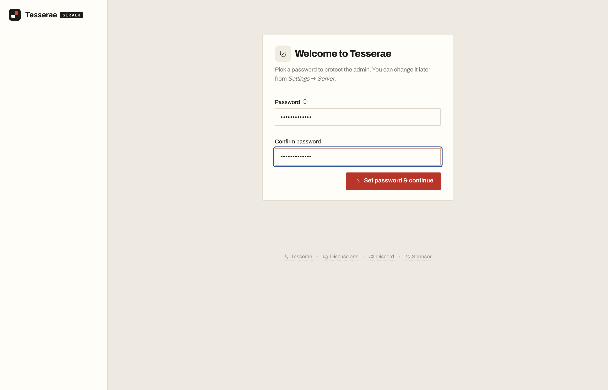

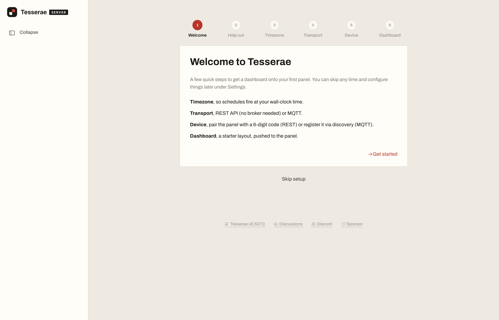

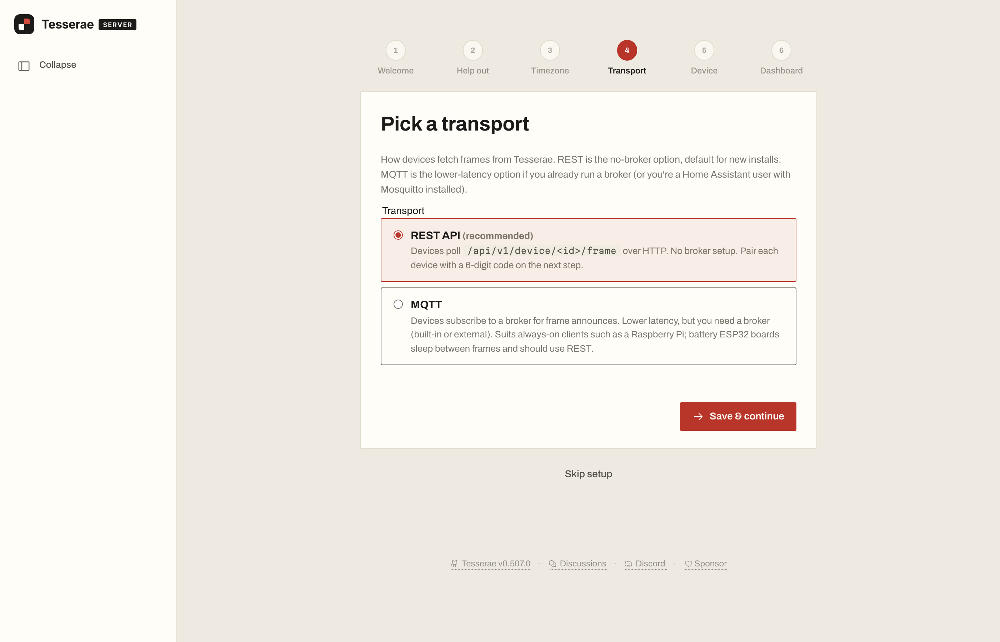

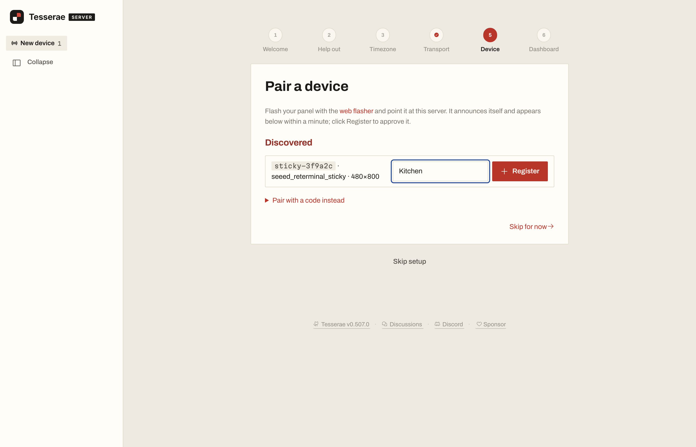

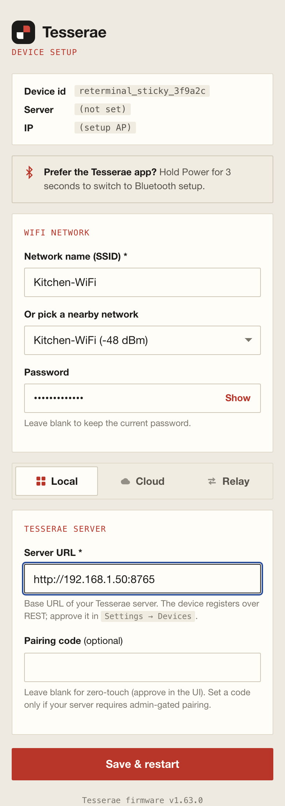

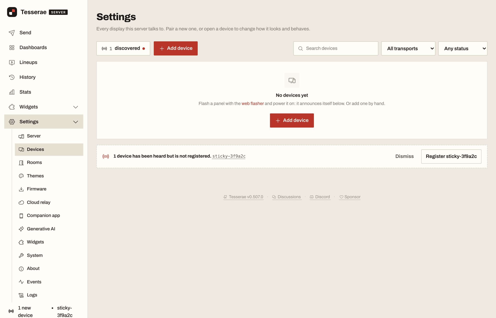

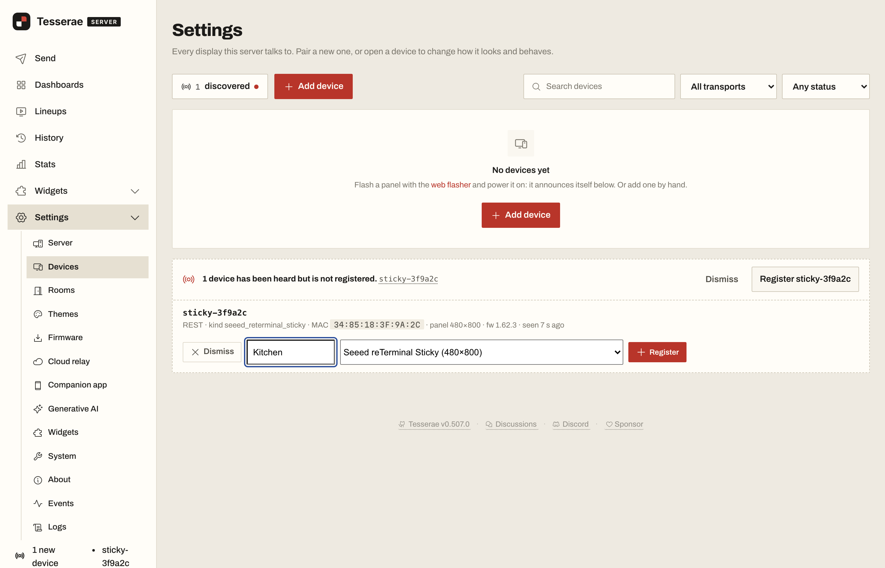

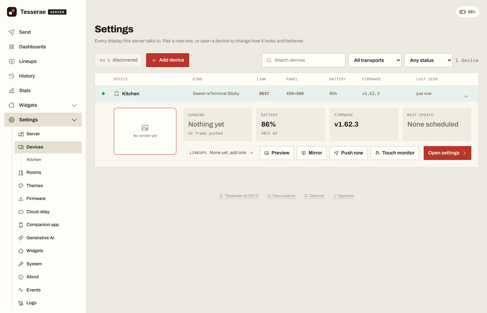

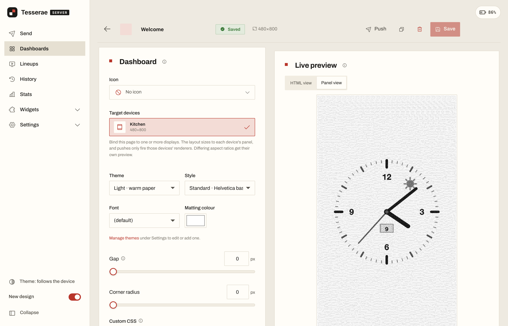

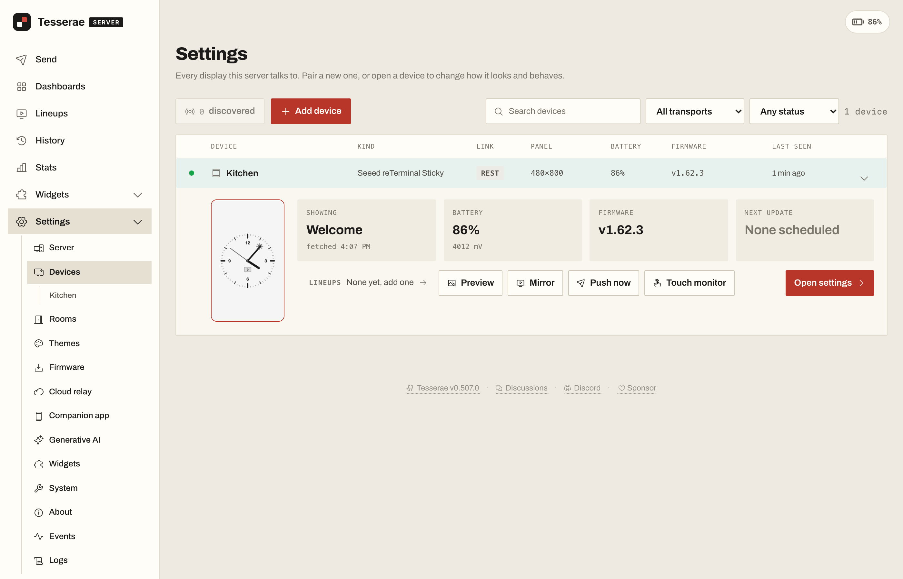

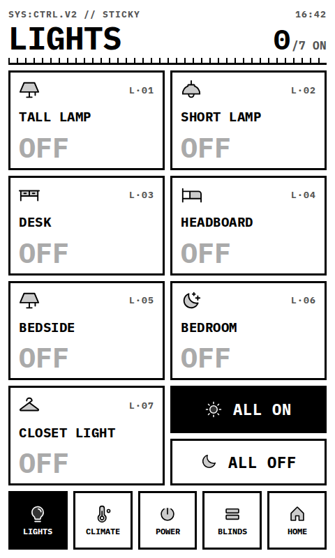

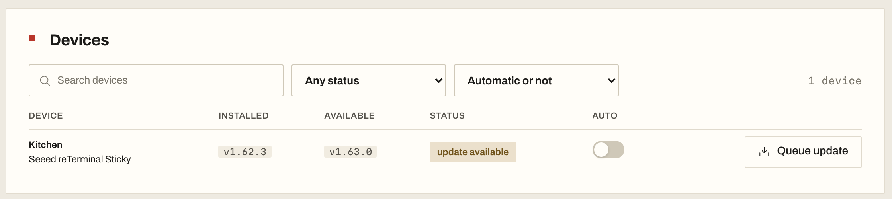

## Still to come

- **Photos of the devices:** a cover shot of the reTerminal family and a Sticky painting dashboards, a device on its setup screen with the QR code, and each device painting a dashboard. The page marks each spot with a `TODO` comment.
- **The Sticky's product image** for the hardware table. I've assumed Seeed already has one on `files.seeedstudio.com`; please point me at it.
- **The Playground link:** the public URL of the Tesserae entry in the Sticky Playground.
- **Two more screenshots:** the tesserae.ink flasher with a reTerminal selected, and the Playground flashing page with the Tesserae entry.
- **Special Thanks:** I'd like to thank people at Seeed by name, as the TRMNL page does, if you're happy with that and tell me who.

## About Tesserae

[Tesserae](https://tesserae.ink) is an open source, self-hosted dashboard server for e-paper displays. Server: [dmellok/tesserae](https://github.com/dmellok/tesserae). Device firmware: [dmellok/tesserae-device-firmware](https://github.com/dmellok/tesserae-device-firmware). Docs: [docs.tesserae.ink](https://docs.tesserae.ink).
