# Tesserae docs for the Seeed Wiki and Firmware Hub

Drafts of two contributions, for review by the Seeed team before the pull requests go in:

| Contribution | Status | Goes to |
|---|---|---|
| [Work with Tesserae](wiki/work_with_tesserae.md), a Wiki page for the reTerminal E1001, E1002, E1003, E1004 and Sticky | Complete, ready for the pull request | [Seeed-Studio/wiki-documents](https://github.com/Seeed-Studio/wiki-documents), at `sites/en/docs/Sensor/ePaper_Displays/Application/work_with_tesserae.md` |
| [Firmware Hub entry](firmware-hub/), an Official Platforms card for the E1001–E1004, EE02 and EE03 | First draft, ready for review | [Seeed-Projects/OSHW-reTerminal-Series-E-D](https://github.com/Seeed-Projects/OSHW-reTerminal-Series-E-D) |

The Wiki page follows the structure of the existing [Work with TRMNL](https://wiki.seeedstudio.com/reterminal_e10xx_trmnl/) page: overview, compatible hardware, numbered steps from install to first dashboard, buttons and touch, firmware updates, FAQ, resources and the standard support footer. Hardware differences are handled with tabs, as on the TRMNL page.

## Reviewing

Comment however suits you: reply by email, open an issue here, or comment on a commit. Wording, structure and anything that doesn't match the Wiki's house style are all welcome.

GitHub shows the page's text and images, but not its Docusaurus parts: the tabs appear as plain sections and the tip and caution boxes as plain text. The screenshots are also listed below in page order.

## Images

The page loads its images from [`wiki/images/`](wiki/images/). As agreed with Mason on 11 November, the pull request includes the images directly, and the Seeed team uploads them to `files.seeedstudio.com` and updates the links.

The screenshots come from a Tesserae server taken through the full setup with a reTerminal Sticky (480×800, 4-level greyscale). The Playground screenshots come from flashing a Sticky there.

| Section | File | Shows |
|---|---|---|
| Cover | `cover.jpg` | Photo: the reTerminal E Series and a Sticky painting Tesserae dashboards (the lineup photo from tesserae.ink) |
| What is Tesserae? | `15-editor-html-view.png` | The dashboard editor |
| Compatible Hardware | `sticky-product.jpg` | The Sticky, cropped from `1X1A0256.JPG` in the product photos Mason sent |
| Step 1, Home Assistant App | `26-ha-app-store-tesserae.png` | Tesserae in the Home Assistant App store |
| Step 1, first run | `01-first-run-set-password.png` | Choosing a password on first open |
| Step 1, first run | `02-wizard-welcome.png` | The setup wizard's welcome step |
| Step 1, first run | `05-wizard-transport.png` | Transport step, REST selected |
| Step 1, first run | `06b-wizard-device-discovered.png` | Device step, a Sticky that has announced itself, ready to register |
| Step 2 | `20-flasher-reterminal-selected.png` | The tesserae.ink flasher with a reTerminal E1002 and a firmware build selected |
| Step 2, Sticky | `21-playground-tesserae-card.png` | The Tesserae card in the Sticky Playground |
| Step 2, Sticky | `22-playground-tesserae-page.png` | The Tesserae page in the Playground: version, flash mode and device log |
| Step 2, Sticky | `23-playground-flash-mode.png` | Flash to device, with Erase flash + flash selected |
| Step 2, Sticky | `24-playground-serial-port.png` | The browser's serial port prompt, showing the Sticky |
| Step 2, Sticky | `25-playground-device-log.png` | The Device Log part-way through flashing |
| Step 3 | `sticky-setup-mode.jpg` | Photo: a Sticky on the Setup mode screen with the QR code |
| Step 3 | `07-device-setup-portal-phone.png` | The device's Wi-Fi setup page on a phone |
| Step 4 | `sticky-almost-done.jpg` | Photo: a Sticky waiting for approval |
| Step 4 | `08-devices-discovered.png` | Settings → Devices, a new device waiting for approval |
| Step 4 | `09-register-name-device.png` | Naming the device before registering |
| Step 4 | `10-device-registered.png` | The registered device's card |
| Step 5 | `16-editor-panel-view.png` | Editor preview in Panel view, the exact frame the device paints |
| Step 5 | `13-device-card-after-push.png` | The device card after the first push |
| Step 5 | `sticky-dashboard-desk.jpg` | Photo: a Sticky on a desk showing a year-progress and clock dashboard |
| Buttons and Touch | `sticky-touch-lights.png` | A touch-controls page rendered for the Sticky |
| Firmware Updates | `19b-firmware-update-available-crop.png` | Settings → Firmware, an over-the-air update available |

Preview every image

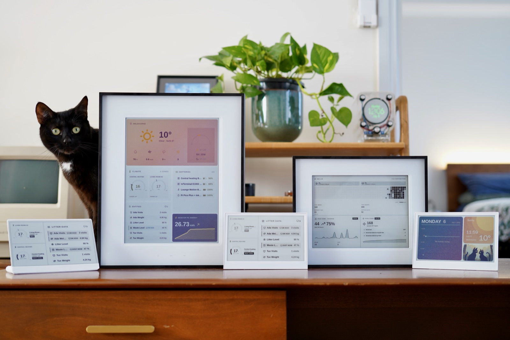

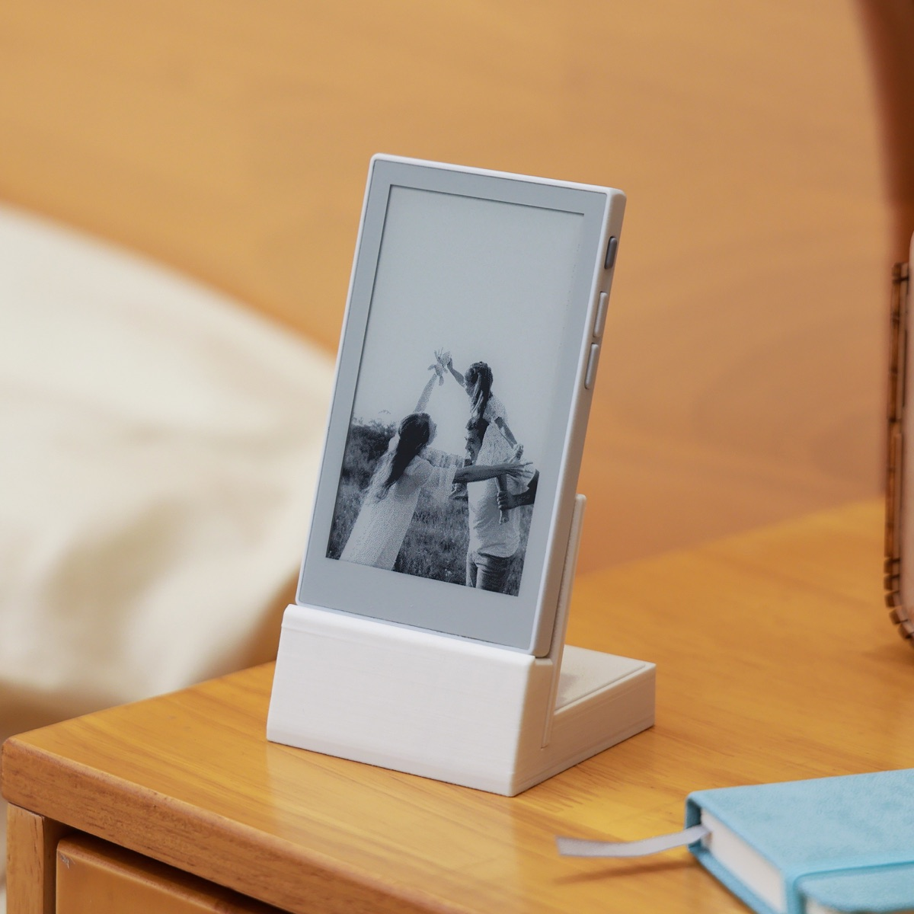

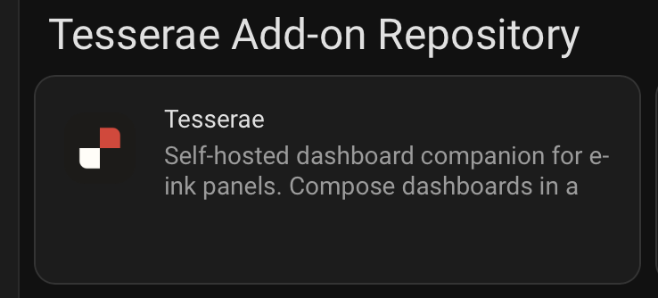

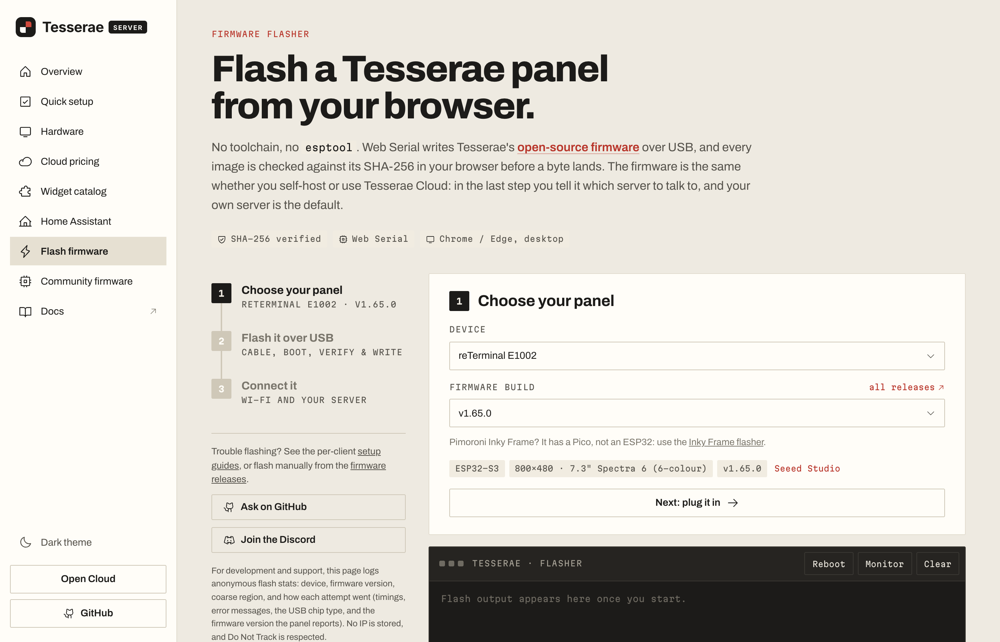

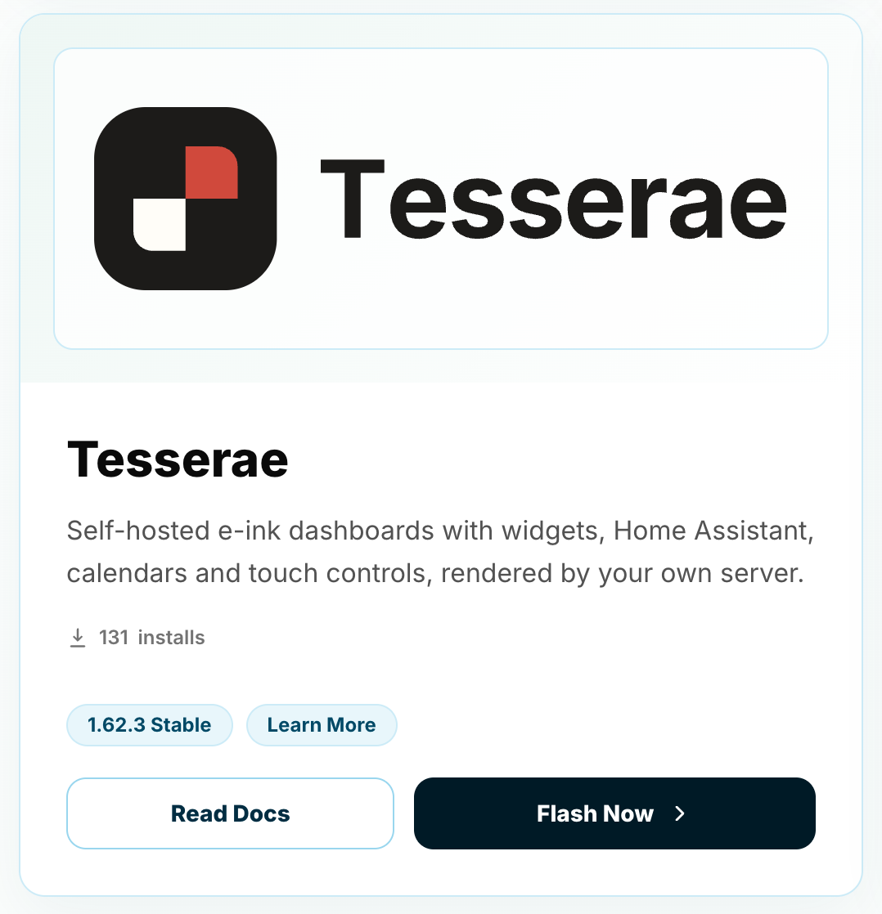

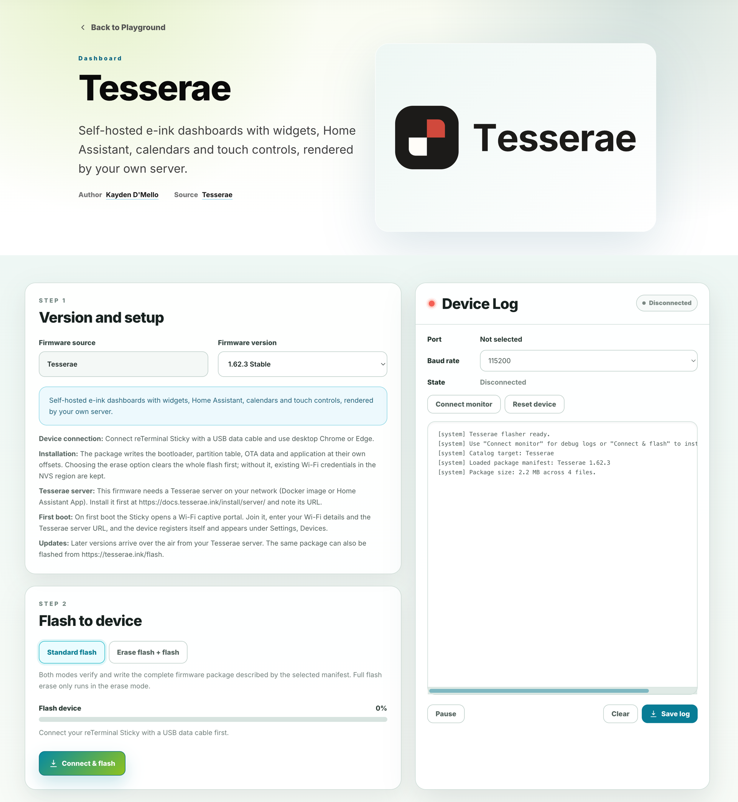

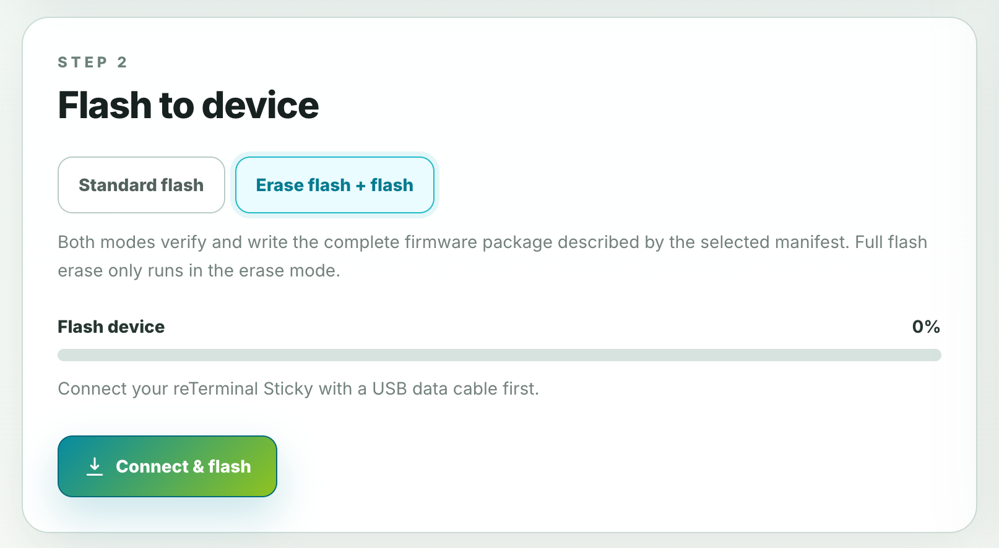

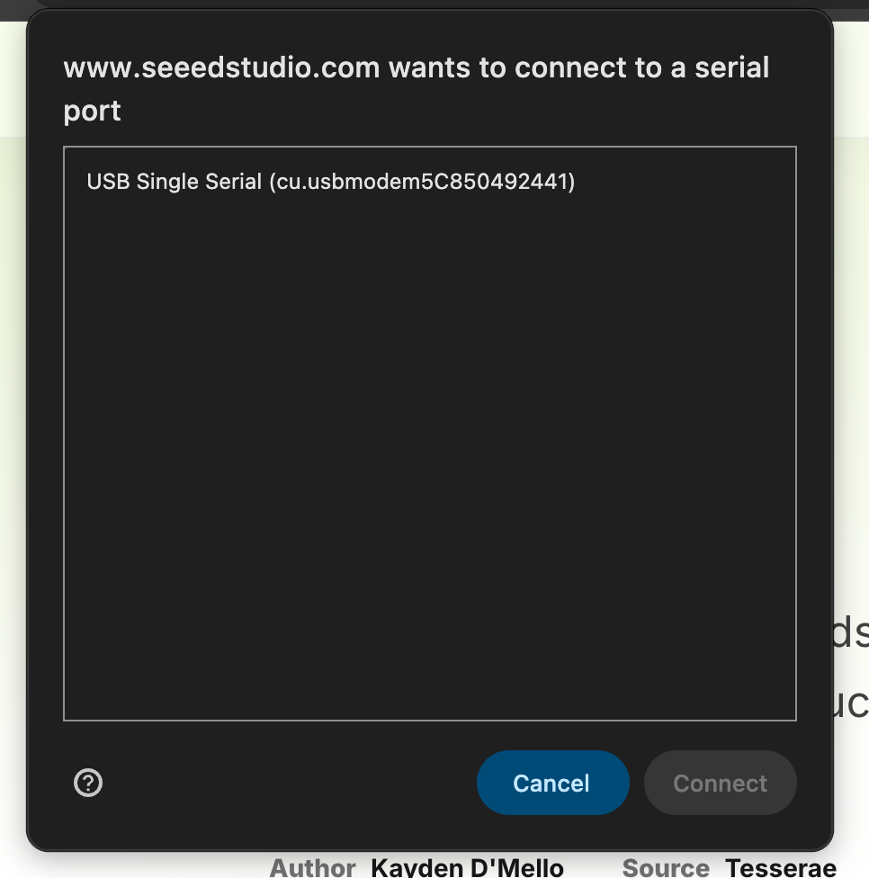

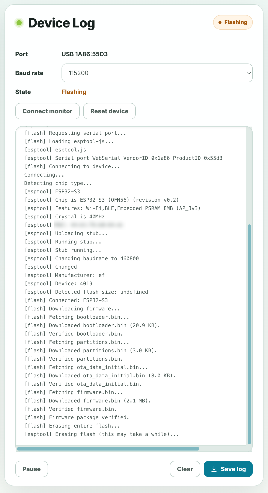

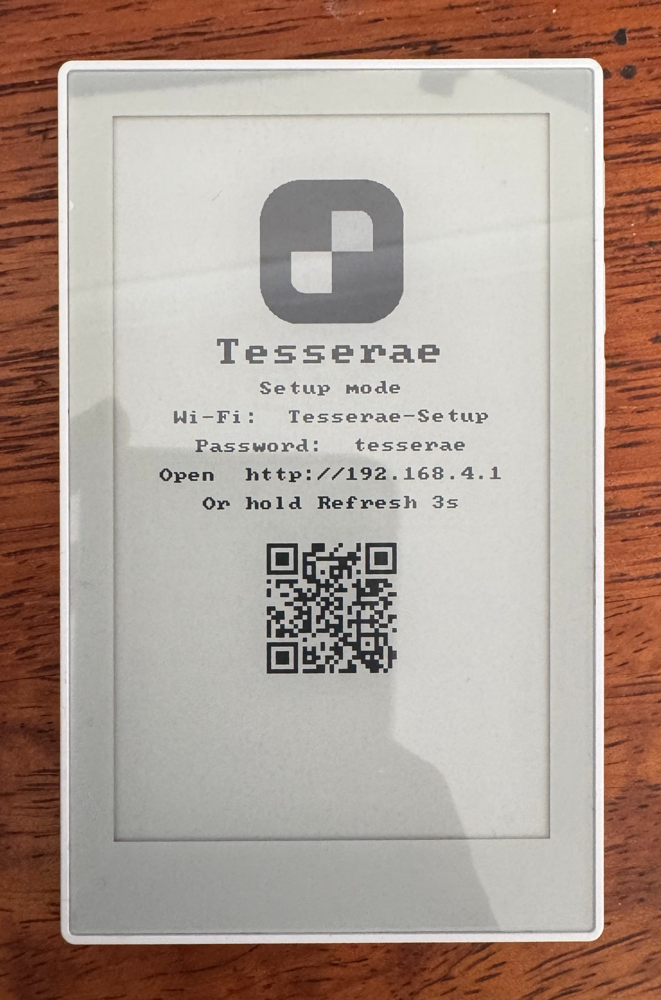

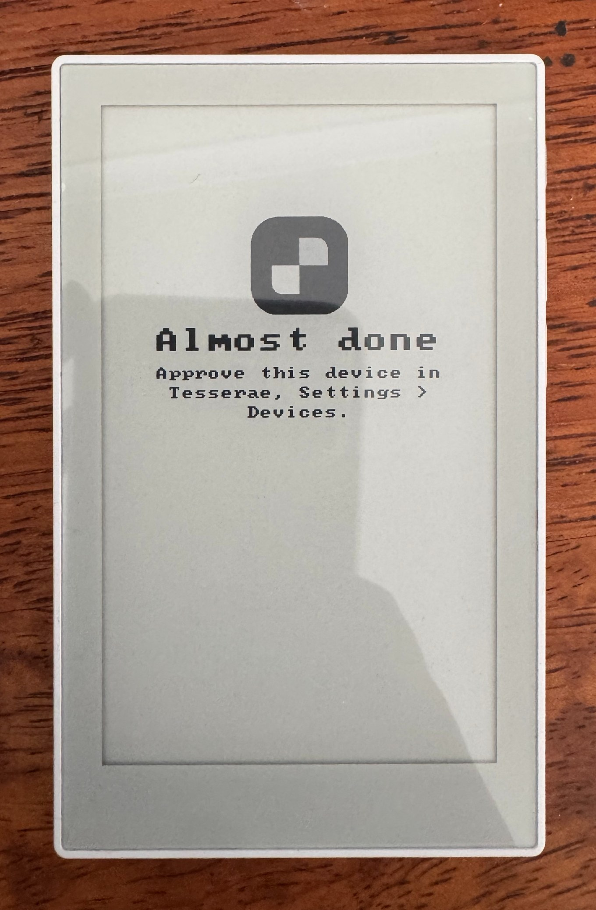

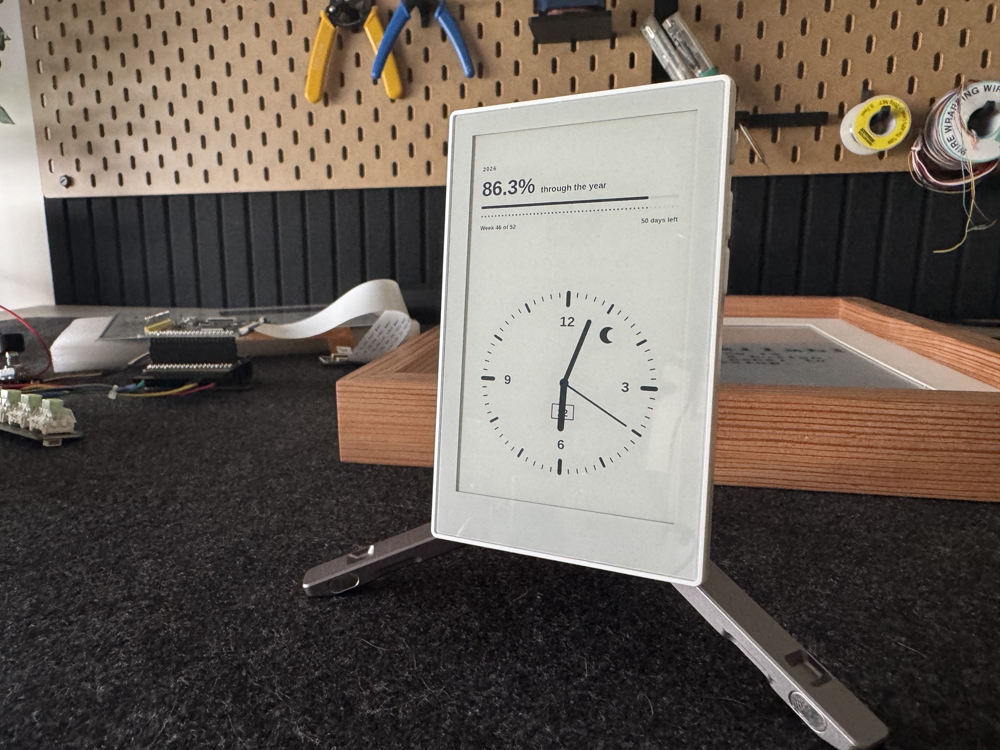

## Settled on 11 November

- **Pull requests** go in directly, and review happens there.
- **Images** travel in the pull request (see above).
- **The Playground link** is https://www.seeedstudio.com/sticky/playground/tesserae/, now in Step 2.
- **Special Thanks** names Mason Cao and Meilily Li, and the Tesserae contributors.
- **The Sticky's image** in the hardware table comes from the product photos Mason sent.

## About Tesserae

[Tesserae](https://tesserae.ink) is an open source, self-hosted dashboard server for e-paper displays. Server: [dmellok/tesserae](https://github.com/dmellok/tesserae). Device firmware: [dmellok/tesserae-device-firmware](https://github.com/dmellok/tesserae-device-firmware). Docs: [docs.tesserae.ink](https://docs.tesserae.ink).
