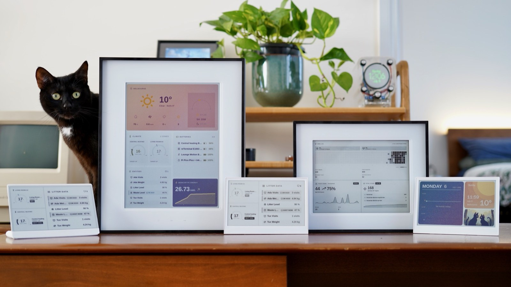

# Tesserae in the reTerminal E-Series Firmware Hub

A draft of the Tesserae entry for the [Firmware Hub](https://seeed-projects.github.io/OSHW-reTerminal-Series-E-D/), for review before the pull request to [Seeed-Projects/OSHW-reTerminal-Series-E-D](https://github.com/Seeed-Projects/OSHW-reTerminal-Series-E-D).

## What it adds

An **Official Platforms** card in **official tool mode**, the same pattern as OpenDisplay and Zephyr. Step 2 opens the Tesserae web flasher with the selected device already chosen, so nothing is built or hosted in the Hub repository.

| File | Change |
|---|---|
| `web/js/firmwares.js` | A `tesserae` card in `PLATFORM_CARDS`, after OpenDisplay ([the card on its own](tesserae-card.js)) |
| `web/assets/platforms/tesserae-logo.svg` | The Tesserae mark, square, for the 36 px logo slot ([file](assets/tesserae-logo.svg)) |
| `web/assets/platforms/tesserae-preview.jpg` | 1600 × 900 preview, the same size as TRMNL's ([file](assets/tesserae-preview.jpg)) |
| `README.md` | A row in the Firmware Platforms table, and the Tesserae step in "how to use" |

The whole change is one patch, [`tesserae-firmware-hub.patch`](tesserae-firmware-hub.patch). It applies cleanly to `main` at `8d97d89`:

```bash
git apply tesserae-firmware-hub.patch
```



## Devices

| Hub device | Flasher link |
|---|---|
| E1001 | `https://tesserae.ink/flash?device=seeed-reterminal-e1001` |
| E1002 | `https://tesserae.ink/flash?device=seeed-reterminal-e1002` |
| E1003 | `https://tesserae.ink/flash?device=seeed-reterminal-e1003` |
| E1004 | `https://tesserae.ink/flash?device=seeed-reterminal-e1004` |
| EE02 (13.3" Spectra 6) | `https://tesserae.ink/flash?device=seeed-ee02` |
| EE03 (10.3" monochrome) | `https://tesserae.ink/flash?device=seeed-ee03` |

**EE04 and EE05 are left out on purpose.** The Hub offers about a dozen panels for each, and Tesserae supports only some of them: the 7.5" monochrome and 7.3" Spectra 6 on the EE04, and the 2.13" four-colour panel on the EE05. Listing the boards would offer combinations that don't work. If the card can be limited to those panels, I'd be glad to add them.

## Why official tool mode

Tesserae publishes signed firmware from its own release pipeline, and devices take later updates over the air from the user's Tesserae server. A flash-mode entry would mean the Hub building a second copy of the firmware from source, outside that release and signing chain. Handing off to the flasher keeps one source of truth, as OpenDisplay and Zephyr do.

One trade-off: the Hub's anonymous install count covers flash-mode cards only, so Tesserae installs started from the Hub won't appear there.

## Before the pull request

- [ ] **Wiki link.** The card links to `https://wiki.seeedstudio.com/reterminal_e10xx_tesserae/`, the [Work with Tesserae](../wiki/work_with_tesserae.md) page in this repo. It goes live once that page is merged, so the Wiki pull request should land first, or the link can come out until then.
- [ ] **Shareable URLs.** Open `?platform=tesserae&device=E1004` (and the other devices) on a local copy of the Hub and confirm Step 2 shows the Tesserae flasher button with the right link.
- [ ] **Copy and images.** Any changes to the wording, logo or preview your team would like.
