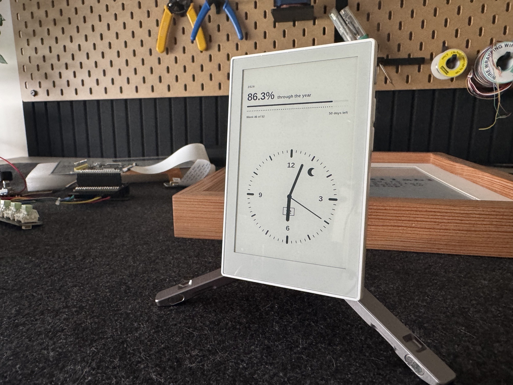
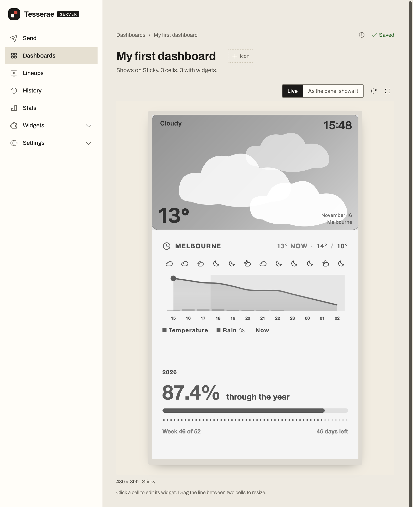
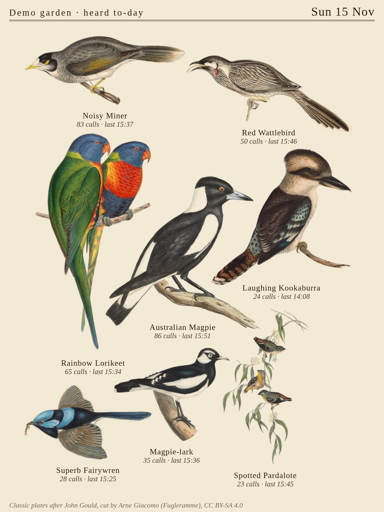
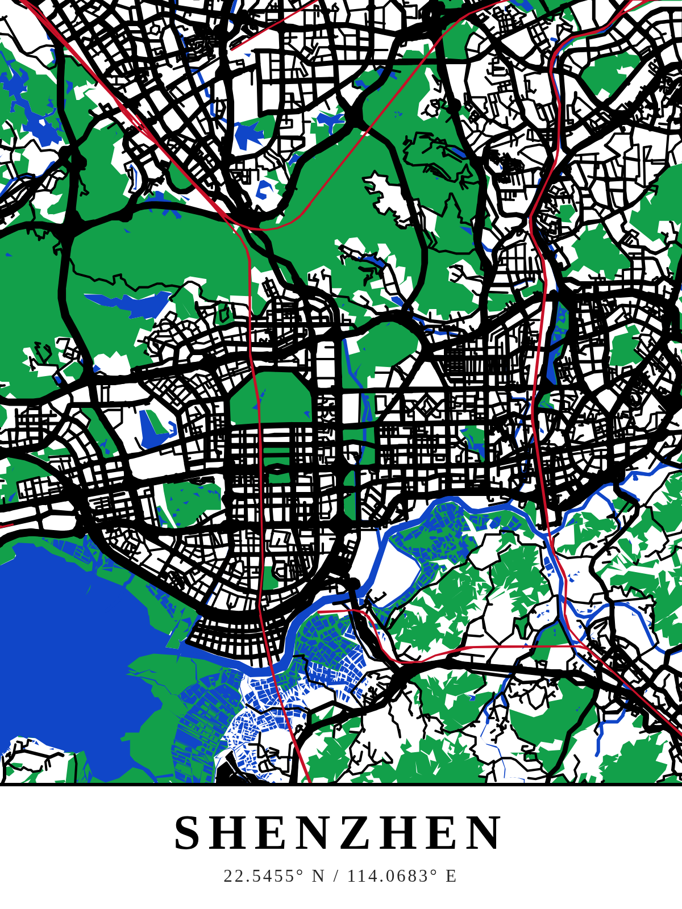
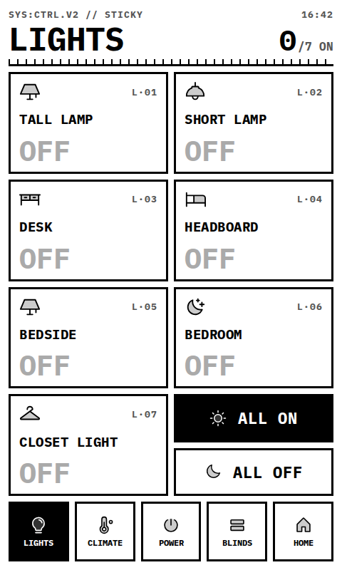
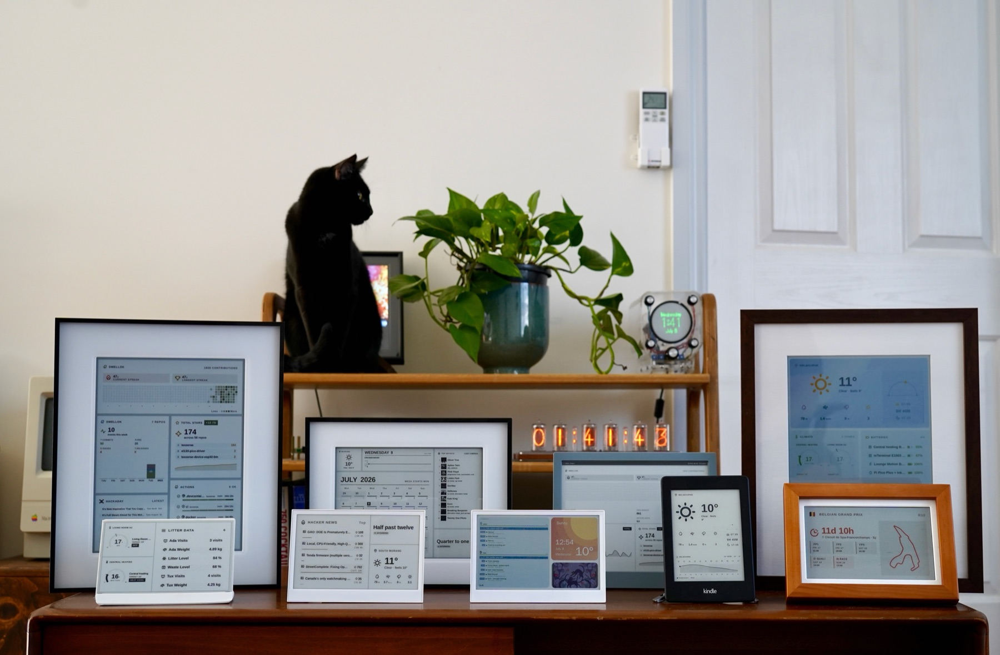
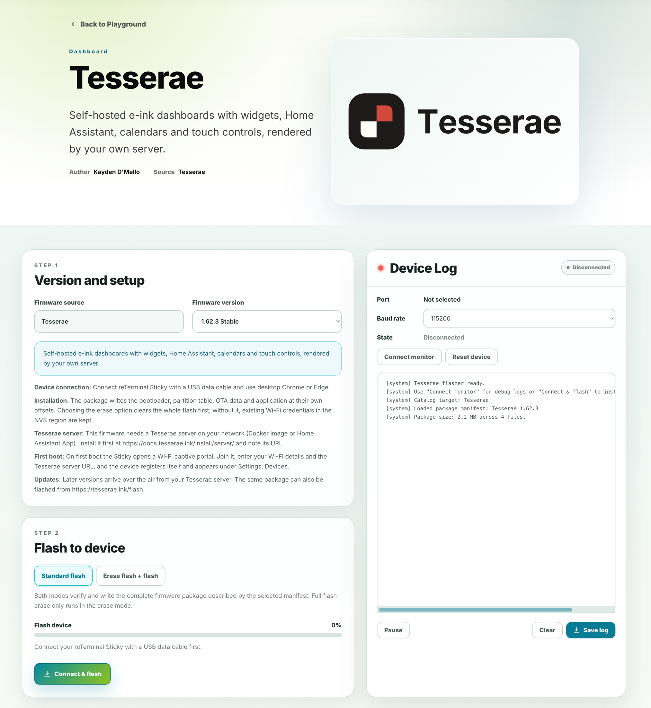
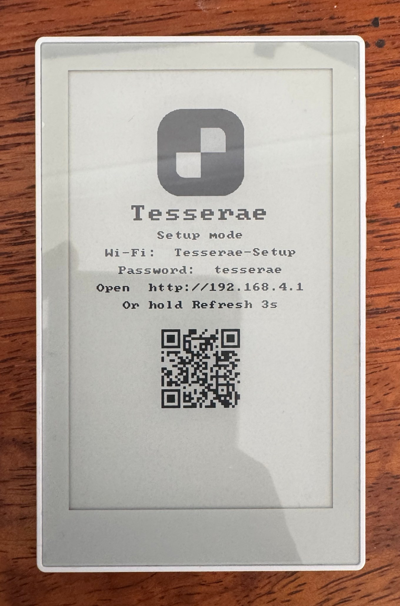
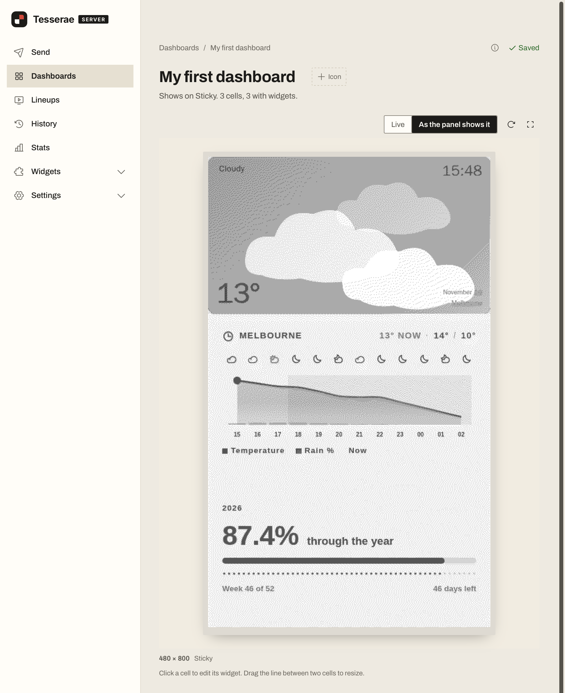
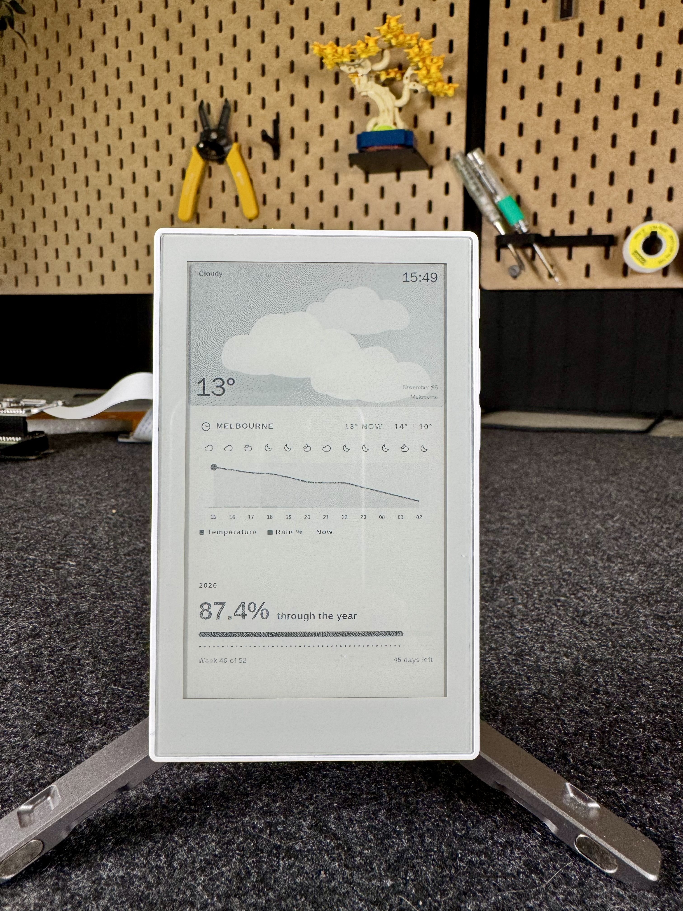

# Tesserae on the reTerminal Sticky: from a fresh device to your first dashboard

*By Kayden D'Mello, creator of Tesserae*

## 1. What Tesserae is, and where it came from

Tesserae is an open source dashboard server for e-paper displays. You run it at home, design dashboards in your browser, and each display fetches its picture, paints it and goes back to sleep. There is no account and no subscription, and nothing leaves your network unless you choose to send it.

I started it because I wanted a simple way to send photos to an e-ink display, along with a few simple dashboards. Nothing I found did that and was completely self-hosted, so I built it. It began as a personal project. Then I thought other people might find it useful too, and the response has been fantastic.

I made the first commit in May 2026, and Seeed hardware has been part of the project almost from the start. The reTerminal E1001 was one of the first devices Tesserae supported. The E1003 followed with 16 levels of grey and touch, then the E1002 and E1004 in full Spectra 6 colour. Each new device pushed the project somewhere it needed to go: the E1003 is why Tesserae has touch at all, and the colour panels are why photos are dithered on the server instead of on the device.

When the reTerminal Sticky launched in July, it fitted straight in. It is small, it runs on a battery, it has a touchscreen, and it is the size of display people leave on a desk or stick to a fridge. Since September, Tesserae has been listed as Partner Firmware in the Sticky Playground, and most weeks the Sticky is among the most-flashed devices in the project.

Today Tesserae has more than 1,200 stars on GitHub and more than 550 active installs in over 50 countries.

What makes it different:

- **It is yours.** The server runs on your own hardware. A hosted option, [Tesserae Cloud](https://cloud.tesserae.ink), exists for people who would rather not run one.
- **It is built for Home Assistant.** Tesserae installs as a Home Assistant App, shows your entities on the display and, on touch devices, can call services back.
- **The server does the hard work.** It renders each frame into the exact bytes the panel expects, so the device only wakes, paints and sleeps. That is what keeps a battery device running for weeks.
- **You flash once.** After the first flash from the browser, firmware updates arrive over the air from your own server.

## 2. Supported Seeed Studio hardware

One firmware family covers the whole range, and the setup steps are the same on every device.

| Device | Display | In Tesserae |
|---|---|---|
| reTerminal Sticky | 480 × 800, portrait | 4-level greyscale, touch, buzzer |
| reTerminal E1001 | 7.5", 800 × 480 | Monochrome and 4-level greyscale |
| reTerminal E1002 | 7.3" Spectra 6, 800 × 480 | Full six-colour output |
| reTerminal E1003 | 10.3", 1872 × 1404 | 16-level greyscale, touch |
| reTerminal E1004 | 13.3" Spectra 6, 1200 × 1600 | Full six-colour output |

The same firmware also runs on the XIAO ePaper family, including the 13.3" Spectra 6 kit (EE02), the 10.3" kit (EE03), the XIAO 7.5" ePaper Panel and the TRMNL 7.5" (OG) DIY Kit. The [compatibility list](https://docs.tesserae.ink/compatibility/) has every supported board.

On all of them, the front buttons and the touchscreen are yours to map. A button can change page, force a refresh or fire a webhook. On the Sticky and the E1003, regions of a page can act as controls.

## 3. What Tesserae solves

An e-paper display is a wonderful thing to own and an awkward thing to feed. Out of the box you usually get one of two choices: a cloud service that decides what you can show, or a blank board and a weekend of writing display code.

Tesserae sits between the two. The dashboard editor walks you through it: pick a display, pick a layout, and choose a widget for each cell. The preview can show the frame exactly as your panel will paint it, and one click on **Push** sends it. There are widgets for weather, calendars, transit, tasks, photos and Home Assistant, and a community catalog of more widgets, themes and complete dashboards. If you want full control, a dashboard can also be plain HTML.

Pairing that with Seeed hardware works well for a simple reason: the devices arrive finished. A Sticky or a reTerminal E has a case, a battery and a good panel, so there is nothing to solder and nothing to print. Tesserae supplies the software side, and between the two you get a display that looks like a product and behaves like your own project.

## 4. What people build with it

A dashboard does not have to be a grid of numbers. These are a few of the widgets people have had the most fun with.

**Specimen Sheet** paints the birds that visited your feeder, in the style of a field guide.

**Overhead** does the same for the aircraft passing over your house, each with its route, height and distance.

**Map Poster** turns any place into a poster-style map. It looks its best on the colour panels.

**A light switch that never glows.** With touch turned on, the Sticky shows your Home Assistant lights as tap targets and confirms each tap with a partial refresh in under a second.

And this is what happens when you can't stop: nine panels, one Tesserae server, and a supervisor.

## 5. Getting started: a fresh Sticky to a first dashboard

The whole thing takes about fifteen minutes, and the only tools are a USB-C data cable and Chrome or Edge on a desktop computer. Here is the short version. The [Work with Tesserae guide on the Seeed Wiki](https://wiki.seeedstudio.com/reterminal_e10xx_tesserae/) has every step with screenshots, so keep it open beside you.

**1. Install the Tesserae server.** If you run Home Assistant, Tesserae installs as an App. Otherwise it is one command on a Raspberry Pi, a NAS, or any computer that stays on. Either way you end up with the web UI on port 8765. If you would rather not run a server, [Tesserae Cloud](https://cloud.tesserae.ink) does it for you.

**2. Flash from the Sticky Playground.** Open the [Tesserae page in the Playground](https://www.seeedstudio.com/sticky/playground/tesserae/), connect the Sticky, choose **Erase flash + flash**, and click **Connect & flash**. The Sticky appears in the browser as **USB Single Serial**. A minute or so later the Playground resets it for you.

**3. Connect it to Wi-Fi.** The Sticky now shows a setup screen with a QR code. Scan it with your phone, pick your 2.4 GHz network, and enter your server's address.

**4. Approve it.** New devices wait for your approval, so nobody else's device can attach itself to your server. In Tesserae, open **Settings → Devices**, click **Register** and give the Sticky a name.

**5. Build a dashboard and push it.** Open **Dashboards → New dashboard** and give it a name, or install a ready-made one from the catalog. The editor takes you through the steps: choose your Sticky as the display, pick a layout, and choose a widget for each cell. Switch the preview to **As the panel shows it** to see the frame exactly as the Sticky will paint it, then click **Push to Sticky**. Press the power button once and the Sticky wakes and paints it.

From here, the Wiki guide covers what to try next: turning on touch so regions of a page can toggle your Home Assistant lights, and setting up a Lineup so the Sticky changes page through the day and stays quiet overnight.

## 6. Working with Seeed hardware

Supporting a device is much easier when the hardware is open and the people behind it answer their email. Seeed has been both. The reTerminal E Series is published as open hardware, which made bringing up each new panel a matter of reading instead of guessing. The team added Tesserae to the Sticky Playground and helped get the Wiki guide published, and they have been quick to answer every question along the way.

What works well:

- **The devices are finished.** A case, a battery and a good panel mean a reader can go from the box to a dashboard in one sitting.
- **The range is consistent.** One firmware family covers every device in the table above, so what you learn on a Sticky carries over to a 13.3" colour panel.
- **Flashing is easy to reach.** The Playground puts the first flash one click away, in a browser.

## Try it

- Flash it: [Tesserae in the Sticky Playground](https://www.seeedstudio.com/sticky/playground/tesserae/)
- Full guide for every reTerminal: [Work with Tesserae on the Seeed Wiki](https://wiki.seeedstudio.com/reterminal_e10xx_tesserae/)
- Project home and documentation: [tesserae.ink](https://tesserae.ink) and [docs.tesserae.ink](https://docs.tesserae.ink/)
- Source: [the server](https://github.com/dmellok/tesserae) and [the device firmware](https://github.com/dmellok/tesserae-device-firmware) on GitHub
- Questions and show-and-tell: [GitHub Discussions](https://github.com/dmellok/tesserae/discussions)

If you build a dashboard on your Sticky, I'd love to see it.
